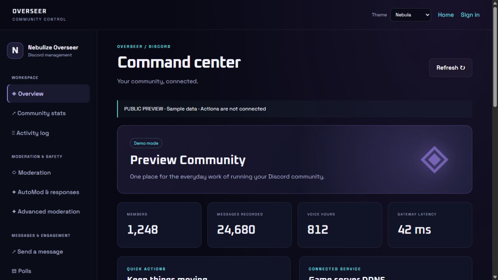
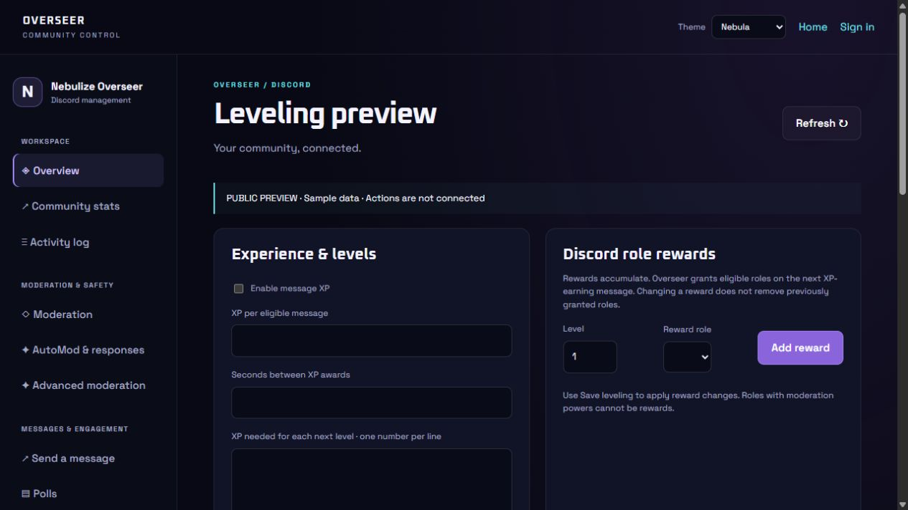

# Nebulize Overseer — public preview

Discord community management, moderation, engagement and website controls in one private build.

**Documentation and visual preview only.** No installer, executable/container download, production configuration, credentials or private application source is included. The private release remains invite-only. GitHub's source archive downloads contain these preview documents and images only.

- [Complete functions and module catalog](MODULES.md)
- [Registered slash commands](COMMANDS.md)
- [Before-install preparation](BEFORE-INSTALL.md)
- [Website access tutorial, including Coolify](WEBSITE-SETUP.md)
- [Website authentication and permission contract](WEBSITE.md)
- [Uptime Kuma guide](UPTIME-KUMA.md)
- [DDNS and Cloudflare guide](DDNS.md)

## Dashboard preview

The screenshot below shows the manager layout with invented sample values. It is a visual demonstration, not a connection to a live Discord server.

## Scope

One server per private installation. External integrations require each operator's own accounts and configuration. Public multi-tenant hosting and AI services are currently out of scope. Public documentation does not grant access to the private runtime.

